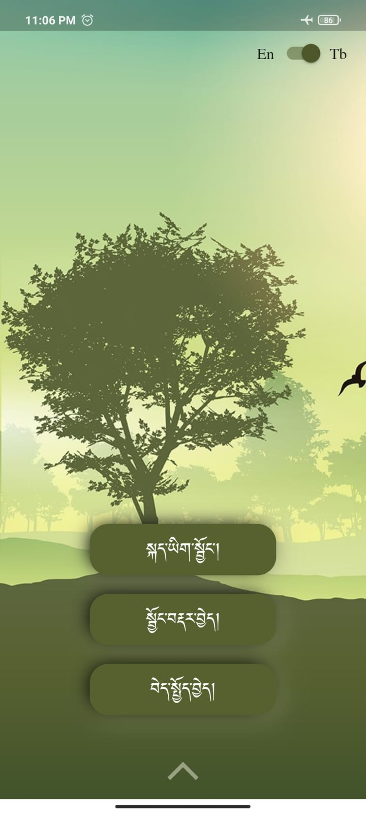
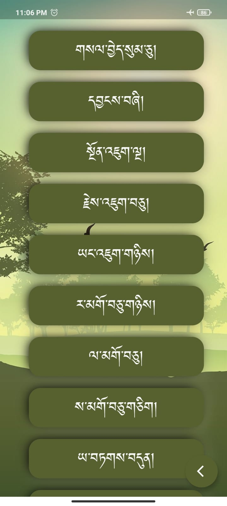
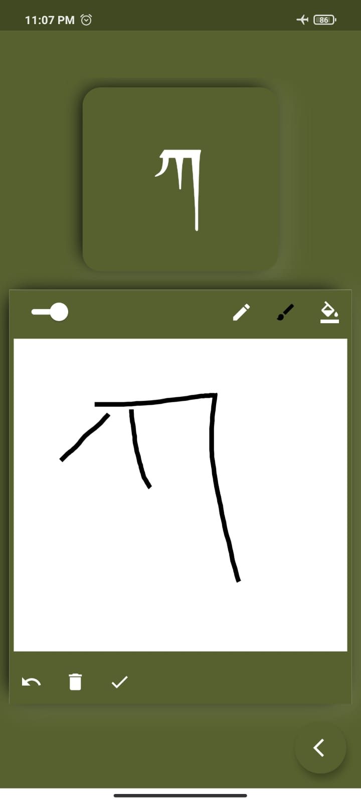
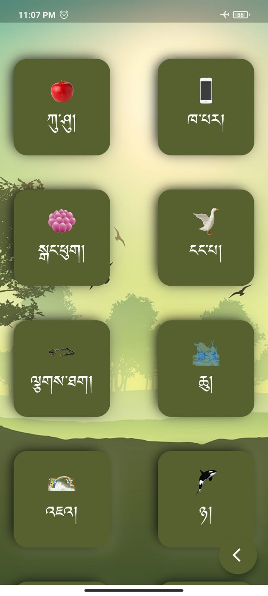

# Tibetan Language Learning App

"Tibetan Language Learning App" let you
1. Learn Tibetan Language
2. Read/Write and practice language
3. Play Spelling bee game

## First released is published in play store...   

Download application from play store: [Tibetan Languae learning app](https://play.google.com/store/apps/details?id=com.kharagedition.tibetan_language_learning_app)

## Getting Started

|  |  |
| :------------: | :------------: |   
| **HomeScreen** | **Alphabet Screen** |
|  |  |
| **Practice Screen** | **Words Screen** |

[Download App](https://play.google.com/store/apps/details?id=com.kharagedition.tibetan_language_learning_app)

flutter build appbundle --target-platform android-arm,android-arm64,android-x64

## Releases (GitHub Actions + fastlane)

Opening a pull request to `main` runs analyze and test once (`ci.yml`); later pushes and the merge don't run it again. Nothing ships until you run **Actions → Release → Run workflow** on `main` and tick what to release:

- **Android**: builds the AAB and uploads it to the chosen Play track (internal, alpha = closed testing, beta = open testing, production).
- **iOS**: builds with the match profiles and uploads to TestFlight. Submit it for review in App Store Connect.

Both store builds use `version:` from `pubspec.yaml`, so bump the build number before every release; each job stops before building if the Play track or TestFlight already has it. The lanes live in `fastlane/Fastfile` (`bundle exec fastlane lanes` lists them).

### One-time setup

Shared by every app on the team, done once:

- An App Store Connect Team API key with the App Manager role.
- A Google Play service account, `play-publisher`, with a JSON key.
- The private match repo `CodingWithTashi/ios-certificates`, its passphrase, and a fine-grained token with Contents: Read-only on it.

For this app:

1. **Play Console:** Users and permissions → the `play-publisher` service account → add this app with permission to release to testing tracks and production.
2. **iOS profiles:** on your Mac, with Homebrew Ruby on `PATH`, run `bundle install`, then `bundle exec fastlane ios certs`. Run it again when the profiles expire.
3. **Secrets:** add these to the repo (Settings → Secrets and variables → Actions).

| Secret | Value |
|---|---|
| `GOOGLE_SERVICES_JSON_BASE64` | Base64 of `android/app/google-services.json` |
| `ANDROID_KEYSTORE_BASE64` | Base64 of the upload keystore (`base64 -i <keystore>.jks`) |
| `ANDROID_STORE_PASSWORD`, `ANDROID_KEY_ALIAS`, `ANDROID_KEY_PASSWORD` | The upload keystore's passwords and alias |
| `PLAY_STORE_JSON_KEY` | The service account's JSON key, pasted whole |
| `ASC_KEY_ID`, `ASC_ISSUER_ID`, `ASC_KEY_P8` | The Team API key's Key ID, the Issuer ID, and the `.p8` file's contents |
| `MATCH_PASSWORD` | The match repo passphrase |
| `IOS_CERT_TOKEN` | The `ios-certificates` token, pasted as GitHub shows it |
